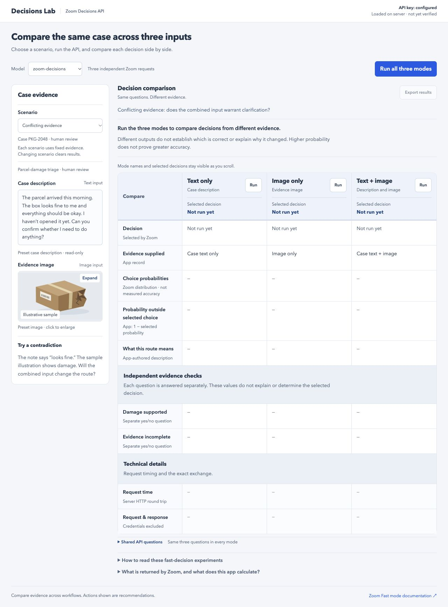

# Decisions Lab

Explore when text, an image, or both provide useful evidence for a decision. Decisions Lab sends the same questions to the Zoom Decisions API in three input modes and compares the answers side by side.

A local, desktop-first developer demo built with Node.js and vanilla JavaScript. No dependencies or build step.



*Default scenario before an API run. Results populate when you run a mode.*

## Quick start

Requirements: Node.js 22+ and a Zoom AI Services API key with Decisions access.

```sh
git clone https://github.com/jenzushsu/zoom-decisions-lab.git
cd zoom-decisions-lab
cp .env.example .env
```

Set `ZOOM_API_KEY` in `.env`, then start the server:

```sh
npm start
```

Open [localhost:3000](http://localhost:3000) in a desktop browser, preferably at least 1280 pixels wide. The interface requires a minimum width of 1180 CSS pixels; narrower windows scroll horizontally.

Credentials stay on the server. Restart after changing `.env` or server-side scenario definitions. Without credentials, the app opens with setup guidance and live runs are disabled. “Configured” means a credential was loaded; a successful API response verifies access.

| Environment variable | Purpose |
|---|---|
| `ZOOM_API_KEY` | API key sent in the `x-api-key` header |
| `ZOOM_ACCESS_TOKEN` | Optional Bearer authentication alternative; used only when no API key is set |
| `PORT` | Local server port; defaults to `3000` |

## Try the scenarios

Choose a scenario, inspect its preset text and image, then run one mode or all three. Inputs are fixed for each scenario so comparisons use consistent evidence. Click the image to enlarge it. Changing the scenario or model clears results.

| Scenario | Example | Question to explore |
|---|---|---|
| Text sufficient | Duplicate billing complaint with a generic account screen | Does the image add relevant information? |
| Image sufficient | Damaged packaging with a neutral note | Can visual evidence establish the condition? |
| Complementary evidence | Team in the note; item and quantity on an item slip | Do both sources fill the information gap? |
| Conflicting evidence | Reassuring note with visibly damaged packaging | How does the decision handle disagreement? |
| Insufficient evidence | Unchecked parcel with a shipping-label close-up | Does the evidence warrant requesting more detail? |

These are illustrative experiments, not benchmark results or guaranteed outcomes. Combined input is not assumed to be more accurate.

## Understand the comparison

Each scenario defines one choice question and two independent yes/no questions. All three modes receive identical questions; only the supplied evidence changes.

| Display | Source |
|---|---|
| Decision | Zoom’s selected choice, mapped to an app label |
| Evidence supplied | App record of the input modes |
| Choice probabilities | Distribution returned by Zoom |
| Probability outside selected choice | App calculation: `1 − selected probability` |
| What this route means | App-authored description, not model-generated reasoning |
| Independent evidence checks | Separately requested predicate probabilities, not explanations of the choice |
| Request time | Server-measured HTTP round trip, including reading the response |
| Request & response | Outgoing request and received body, with credentials excluded or redacted |

Choice answers may omit `confidence`. The app uses returned probabilities and preserves optional fields in the response viewer. Probabilities are not measured accuracy; assess accuracy with labeled examples. Refusals and errors remain visible rather than being replaced with sample results.

Expand **Shared API questions** to inspect the exact instructions and choices. Export results to save the comparison and exchanges. Exports include submitted text and full image data, so review them before sharing.

## API integration

The server sends requests to `POST https://api.zoom.us/v2/aiservices/decisions/decide`.

- Text-only requests use a text string.
- Image and combined requests use user-message content with `input_image` and, for combined input, `input_text`.
- Images are inline data URLs with `detail: "auto"` and `enable_image_input: true`.
- Supported model options are `zoom-decisions` and `zoom-decisions-pro`.
- Scenario IDs select trusted question definitions locally; they are not forwarded to Zoom.
- The app generates a `reference_id` for request tracking; it does not assume Zoom echoes it.

See Zoom’s [API reference](https://developers.zoom.us/docs/api/ai-services/), [Fast mode guide](https://developers.zoom.us/docs/ai-services/decisions/fast-mode/), and [Decisions overview](https://developers.zoom.us/docs/ai-services/decisions/) for service requirements and current API documentation.

## Development

```sh
npm test
```

Tests use local fixtures and a simulated upstream service; no API key or live Zoom request is needed. They cover input isolation, validation, probability handling, refusals, exchange capture, and identical questions across all input modes. Test fixtures are not a user-facing run mode.

| File | Responsibility |
|---|---|
| `server.mjs` | Local HTTP server, static assets, and server-side API proxy |
| `decisions.mjs` | Request construction and response validation |
| `workflows.mjs` | Scenario definitions and shared questions |
| `public/` | Desktop interface and locally generated evidence images |
| `*.test.mjs` | Request and response tests |

The proxy limits text to 12,000 characters and images to 4 MB, supports PNG/JPEG/WebP, allows six concurrent requests, and times out upstream requests after 45 seconds. These are app limits, not Zoom service limits. Logs contain request metadata, not credentials or submitted evidence. There is no server-side result storage.

## Local demo scope

The server binds to `127.0.0.1`. Publishing this source repository does not make the proxy a production service. Before hosting it for other users, add authentication, HTTPS, per-user rate limits, and managed secrets. Keep `.env` out of version control; `.env.example` contains only empty configuration fields and the default port.
